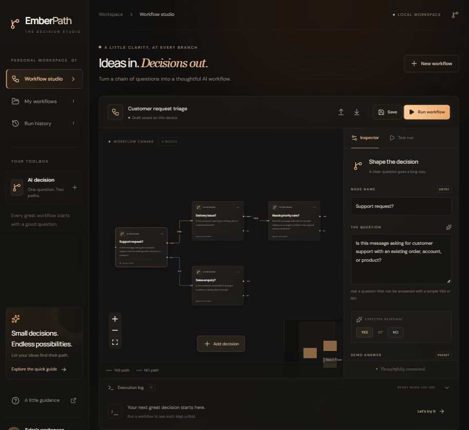

# ✳ EmberPath

A little clarity, at every branch.

A visual AI workflow studio. Ask a question, connect the YES and NO paths, and let each answer decide what happens next. Built around a dark canvas, smoked glass, and a little amber glow.



## ✨ What it does

- **Build visually** — add decision nodes, edit their prompts, and connect their YES / NO outputs.
- **Follow the thinking** — see active nodes, animated paths, ordered logs, and the final result.
- **Run reliably** — Inngest executes each decision as a durable step with automatic retries.
- **Keep your ideas** — drafts autosave locally; save workflows to your library or export / import JSON.
- **Revisit a path** — inspect execution history and resume a failed run at its failed node.
- **Try it first** — Demo uses editable preset answers. Live AI evaluates your input through OpenAI.

## 🧩 How it works

```text
Your input → Entry decision → OpenAI returns YES or NO
                                      ↓
                            Follow the matching edge
                                      ↓
                            Evaluate the next decision
                                      ↓
                         No connected edge? Run complete.
```

Every visited node maps to an Inngest `step.run`. The same original input is evaluated against each node’s question. Only an exact `YES` or `NO` is accepted; invalid model responses fail the step and trigger retries. Each output accepts one connection, and cycles are rejected before execution.

Demo runs through the same Inngest workflow using each node’s preset answer. It does not call AI or interpret your input.

## 🛠️ Tech stack

| Layer                | Tools                                                  |
| -------------------- | ------------------------------------------------------ |
| App & API            | Next.js App Router, React, TypeScript                  |
| Visual editor        | React Flow (`@xyflow/react`)                           |
| Workflow execution   | Inngest                                                |
| AI decisions         | OpenAI SDK                                             |
| Interface            | Tailwind CSS, shadcn/ui-style Radix primitives, Lucide |
| Typography           | Self-hosted Manrope and DM Sans, Georgia accents       |
| Validation & storage | Zod, browser localStorage, local JSON run files        |

## 📂 Project structure

```text
EmberPath/
├── src/
│   ├── app/
│   │   ├── api/inngest/       # Inngest function endpoint
│   │   ├── api/runs/          # Start runs, poll status, read history
│   │   ├── globals.css        # Glass theme and responsive layouts
│   │   ├── layout.tsx
│   │   └── page.tsx
│   ├── components/
│   │   ├── ui/                # Buttons and accessible glass dialogs
│   │   └── workflow-studio.tsx
│   ├── inngest/               # Client and durable decision workflow
│   └── lib/                   # Graph validation, types, run storage
├── examples/                  # Importable starter workflow
├── tests/                     # Graph rules and integration checks
├── .github/workflows/ci.yml
├── .env.example
└── components.json            # shadcn configuration
```

## 🚀 Getting started

Use **Node.js 24 LTS** and npm.

```bash
git clone https://github.com/FaizaEsha/EmberPath.git
cd EmberPath
npm install
```

Copy `.env.example` to `.env.local`:

```powershell
# PowerShell / VS Code on Windows
Copy-Item .env.example .env.local
```

On macOS or Linux, use `cp .env.example .env.local` instead.

Start the app:

```bash
npm run dev
```

In a **second terminal**, start Inngest:

```bash
npm run inngest
```

Open **[EmberPath](http://127.0.0.1:3000)**. The **[Inngest dashboard](http://127.0.0.1:8288)** shows the registered function and its steps. Both servers need to stay running, including for Demo.

If your package manager skips the Inngest CLI install script, run `npm rebuild --ignore-scripts=false inngest-cli` before starting it.

### Connect live AI

Set these values in `.env.local`, then restart the app:

```dotenv
OPENAI_API_KEY=your_openai_api_key
OPENAI_MODEL=gpt-4.1-mini
INNGEST_DEV=1
```

Choose **Test run → Live AI**. Your key stays on the server; live runs use your OpenAI account’s quota. You can choose another chat-completions-compatible model available to your account.

## 🧪 Take it for a spin

The starter asks whether a message is a support request, whether it involves delivery, and whether it needs priority care. Try:

> I paid for my order a week ago, but it still hasn't arrived. Could someone help me track it down?

1. Open **Test run**, choose **Demo**, and run the workflow. The preset YES path visits three decisions.
2. Return to editing, select **Support request?**, and change its demo answer to **NO**. The next run follows the sales branch.
3. Switch to **Live AI** to evaluate the message rather than preset answers.

Drag from a node’s YES or NO port to another node’s left port to connect them. Click a connection to change its branch or remove it. An unconnected answer ends the run; set a node as the entry point from the Inspector.

## ✅ Checks

```bash
npm run typecheck
npm test
npm run build
```

With both local servers running:

```bash
npm run test:integration
```

Integration checks exercise real Inngest runs, both branches, validation, session isolation, history, and resuming a failed node. They create sample runs locally and do not call OpenAI. Pull requests run type checking, unit tests, and the production build through GitHub Actions.

For a production build locally, run `npm run build`, then `npm start`; keep Inngest running in the second terminal.

## A few practical details

Workflows are stored in this browser; run snapshots and logs are stored in `.data/runs/` on the server. Neither API keys nor run data are committed. Export workflows before clearing browser storage. Graphs allow up to 40 decisions and support acyclic paths.

This is a local development app. Before public hosting, add user authentication, rate limits, and shared database storage; replace development Inngest settings with your event and signing keys. Node decisions classify input; they do not send emails or perform external business actions.

## ✍️ Author

Faiza Ahmed Esha
